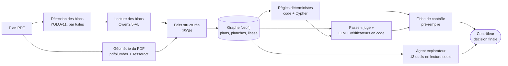

<!--
NOTE POUR YASSINE (invisible sur GitHub) :
- Corrigé d'après le code de ControlPlan :
  * aucune intégration ERP dans le code → retirée partout (titre, schéma, stack, résultats). Si une intégration existe ailleurs, la remettre avec ses vrais contours ;
  * le modèle YOLO déployé utilise des boîtes droites, pas des boîtes orientées (OBB). Si une version antérieure utilisait l'OBB, le dire dans « Choix techniques » ;
  * le juge ne vérifie pas l'agent explorateur : ce sont deux chemins séparés (voir schéma) ;
  * les « alias » de l'explorateur sont des alias de NŒUDS du graphe (d1, s2…), pas de noms d'outils.
- À confirmer : Roboflow pour l'annotation des plans réels, les dates du stage, le modèle de la passe juge sur le serveur (gpt-oss 20B ?).
- Section 7 : chiffres tirés des mesures du projet (banc d'essai, passes de jugement, durées des imports), SAUF le temps de contrôle manuel, qui est une estimation à remplacer par une mesure. Pas de mAP : aucune mesure n'existe dans nos échanges, remplacée par les seuils et le point faible connu de la détection.
- Images (dossier docs/) : nom du fichier, cartouche, identifiants de nœud, n° de la note qualité, contenu de la note interne et nom du modèle de référence floutés. À faire valider par ECM comme le texte.
- Faire valider par ECM avant publication : aucun code, aucune donnée, aucun nom de client, de pièce ou d'affaire, aucun numéro de formulaire interne.
-->

# Control Plan AI : pré-contrôler des plans mécaniques avec la vision, un graphe et des LLM locaux

**Étude de cas** · Projet mené pendant mon stage d'ingénieur IA chez **ECM** (avril – octobre 2026) · **Déployé** sur un serveur interne, en essai auprès des contrôleurs

> Le code et les données appartiennent à ECM : ce dépôt ne contient **ni code ni donnée**. Il décrit le problème, l'architecture, mes choix techniques, les incidents rencontrés sur des plans réels et ce que j'en ai tiré.

---

## 1. Le problème

Chez ECM (chaudronnerie, mécanosoudure), chaque plan est contrôlé avant diffusion à l'aide d'une **fiche de contrôle** : une liste de points à vérifier un par un (cartouche complet, références et indices cohérents entre les planches, nomenclature cohérente avec les repères dessinés, notes de soudure et de finition, normes citées…).

Ce contrôle est fait **à la main**. Il est long et répétitif, surtout pour un sous-ensemble de plusieurs planches qui renvoie vers d'autres plans, et une incohérence entre deux planches ou entre deux plans se rate facilement.

**Objectif** : lire le plan automatiquement, relier ce qu'il contient dans un graphe, appliquer les règles de contrôle de l'entreprise et **pré-remplir la fiche** avec, pour chaque ligne, une conclusion appuyée sur des preuves. **Le contrôleur garde la décision** : l'outil propose, il ne signe rien.

---

## 2. Ce que fait le système

1. **Détection** : YOLOv11 repère les blocs utiles (cartouche, notes, cadres de tolérance) sur des plans grand format, en découpant la page en tuiles de 1024 px (une planche A1 en compte environ 108).
2. **Lecture** : Qwen2.5-VL lit chaque bloc et rend du JSON. En parallèle, la géométrie du PDF (pdfplumber) et l'OCR (Tesseract) mesurent les vues, les cotes, les repères et l'échelle.
3. **Structuration** : les faits sont écrits dans un **graphe Neo4j** (plan → planches → cartouche, notes, nomenclature…), avec des identifiants déterministes : chaque valeur reste reliée à sa source. Les plans d'une même affaire sont reliés entre eux (la « liasse » : quel plan détaille chaque ligne de nomenclature).
4. **Contrôle** : un moteur de **règles déterministes** tranche tout ce que le code sait trancher. Une **passe « juge »** (LLM) relit ensuite les conclusions de l'outil ligne par ligne sur un dossier fermé, et **ses réponses sont vérifiées par du code**.
5. **Fiche** : la fiche de contrôle Excel est pré-remplie (OK / NOK proposé, preuve, niveau de confiance). Le contrôleur valide ou corrige dans l'interface.
6. **Exploration** : un **agent** répond aux questions du contrôleur en naviguant dans le graphe avec 13 outils typés en lecture seule. Il n'écrit rien dans la fiche.
7. **Service** : API FastAPI et interface React, conteneurisées avec Docker Compose sur un serveur interne. Les imports tournent en tâche de fond, avec un suivi en direct.

### En images

*Les blocs repérés par YOLO sur une planche (tableau de révisions, textes libres, cartouche, nota), lus ensuite un par un par le modèle de vision. Nom du plan et cartouche floutés.*

*Une ligne de la fiche : ce qui a été relevé sur le plan, les normes citées et, à droite, la page de la note qualité qui s'y rapporte. Le contrôleur décide OK / NOK. Identifiants et contenu de la note interne floutés.*

---

## 3. Stack

| Domaine | Outils |
|---|---|
| Vision | YOLOv11 (Ultralytics), inférence par tuiles façon SAHI ; 1re version entraînée sur des données synthétiques ; annotation Roboflow |
| Lecture du PDF | pdfplumber (géométrie vectorielle), Tesseract (OCR des cotes et des lignes de texte) |
| Modèles de langage | Qwen2.5-VL 7B (lecture des blocs), gpt-oss 20B (raisonnement : passe juge, agent explorateur), servis **en local** avec **Ollama / Open WebUI** |
| Données | Neo4j (Cypher), règles de contrôle décrites en YAML |
| Service | Python, FastAPI, React + TypeScript (Vite), Docker Compose |
| Sortie | Fiche de contrôle Excel (openpyxl) |
| Qualité | Traces JSONL, tests avec modèle scripté, banc d'essai sur plans réels, statistiques de rejet |

---

## 4. Choix techniques et pourquoi

| Choix | Pourquoi |
|---|---|
| **Détecter d'abord (YOLO), lire ensuite (VLM)** | Le modèle de lecture ne voit que la zone utile : moins de bruit, des résultats plus stables et plus faciles à vérifier. Sur un plan grand format, la détection se fait par tuiles, comme à l'entraînement, puis les blocs coupés entre deux tuiles sont recollés. |
| **1re version de YOLO entraînée sur des données synthétiques que j'ai générées** | Démarrer sans attendre un grand jeu de plans annotés, puis affiner avec des plans réels annotés. |
| **Mesurer la géométrie du PDF plutôt que la faire lire** | L'échelle, le nombre de vues, les cotes et les repères se mesurent dans le PDF vectoriel : une mesure est plus fiable qu'une lecture du modèle. |
| **Modèles servis en local (Ollama)** | Les plans restent dans l'entreprise. J'ai aussi testé des versions **quantifiées** de Qwen-VL sur GPU pour arbitrer entre mémoire, vitesse et qualité. |
| **Graphe Neo4j, identifiants déterministes** | Les informations d'un plan, et les plans entre eux, sont liés : le graphe les interroge par relations et **trace chaque valeur jusqu'à sa source**. Réimporter un plan retrouve les mêmes nœuds. |
| **Des règles déterministes d'abord, le LLM ensuite** | Sur 127 règles de contrôle, 93 sont tranchées par du code. Le LLM ne reçoit que les 34 règles « de jugement » que le code ne sait pas trancher. |
| **Le LLM ne décide jamais OK / NOK** | Il donne un avis motivé et cité. Un écart qu'il signale n'est jamais un NOK ferme : la décision reste au contrôleur. |
| **Identifiants courts dans les prompts** | Un modèle de 7B recopie de travers un identifiant Neo4j complet environ une fois sur trois. Un identifiant court inventé, lui, se repère tout de suite. |
| **Aucune valeur tirée d'un vrai plan dans un prompt** | Le modèle recopie les exemples sur les plans suivants (voir les incidents). |
| **Outils de l'agent typés et en lecture seule** | L'agent explore sans rien pouvoir modifier ni écrire de requête libre : une erreur du modèle ne casse rien, et chaque appel est traçable. |
| **Appels déterministes (température 0, seed fixe)** | Rendre les résultats reproductibles, pour tester et pour rejouer un incident. |

---

## 5. Fiabiliser ce que produit l'IA : le « harness »

Le plus gros du travail n'a pas été d'appeler des modèles, mais de **pouvoir faire confiance à leurs sorties**.

### Client de modèle partagé
- Un seul client pour les appels de raisonnement : température 0, seed 42, **taille de contexte explicite**. Sans elle, Ollama tronquait le prompt sans prévenir, et les consignes disparaissaient en premier.
- Un modèle injoignable lève une erreur dédiée (`ModelUnavailable`) : l'interface affiche l'indisponibilité, l'application ne plante pas.

### Passe « juge » : un seul appel, un monde fermé
- **Le code fixe le périmètre** : il choisit les règles applicables au type de plan et assemble un **dossier fermé** (toutes les planches du plan, un résumé des plans liés, les conclusions de l'outil pour chaque ligne de la fiche). Chaque élément porte un **identifiant court** que le juge doit citer.
- On dit au modèle **ce que personne n'a lu** (vues, symboles de soudure…) : « non extrait » n'est pas « absent ».
- **Budget de contexte** : si le dossier dépasse la fenêtre du modèle, le code retire d'abord le moins utile et **dit au modèle ce qu'il a retiré**, pour qu'il n'en conclue pas une absence.
- **Sortie JSON** à vocabulaire fermé (`present`, `absent`, `ok`, `nok`, `partiel`, `non_verifiable`).
- **Deux vérificateurs écrits en code** rejettent ou signalent :
  - une citation absente du dossier, ou une conclusion `ok` / `nok` sans citation ;
  - une **valeur chiffrée introuvable dans les éléments cités** ;
  - une absence affirmée sans preuve, ou contredite par un élément du dossier ;
  - un désaccord avec l'outil sans avoir relu les planches où l'outil situe l'écart.
- **L'accord ou le désaccord avec l'outil est calculé par le code**, pas déclaré par le modèle.
- Chaque rejet est gardé avec sa raison et compté : le **taux de rejet** mesure ce que vaut le modèle sur la tâche.
- Un **fournisseur manuel** (`ManualProvider`) écrit le prompt sur disque et relit la réponse d'un autre modèle ou d'un humain, qui passe par les mêmes vérificateurs : de quoi comparer des modèles sur exactement la même tâche.

*Une passe de jugement de référence, déposée via le fournisseur manuel : 15 propositions, 5 constats gardés, 9 « conformes », 1 rejeté par le vérificateur parce qu'il citait un élément absent du dossier (`n7`). Capture de septembre 2026 : la base comptait alors 92 règles.*

### Agent explorateur du graphe : une boucle d'outils
- **13 outils typés en lecture seule** (plan, planche, nomenclature, liasse, constats, règles, recherche, comparaison de deux plans…), décrits au modèle par un schéma JSON. Aucune requête Cypher libre.
- **Le modèle ne voit jamais un identifiant interne** : chaque nœud rencontré reçoit un alias court (`d1`, `s2`, `n3`…) qu'il doit citer entre crochets.
- **Résultats compacts** : listes et textes plafonnés ; une réponse d'outil de plus de 6 000 caractères est tronquée, avec l'invitation à demander plus précis.
- **Boucle limitée à 12 étapes** ; budget épuisé, un dernier appel sans outils force la réponse.
- Deux modes : une question libre, ou une **« ronde »** guidée qui fait le tour d'un plan. Ses relevés sont des hypothèses, jamais des constats.
- `verify()` signale tout alias qu'aucun outil n'a rendu. Un **drapeau « incomplet »** signale un outil annoncé mais jamais appelé, ou une étape de la ronde sautée.
- Chaque exploration est **tracée** (`explore.jsonl` : chaque appel, ses arguments, sa durée, les tokens) et notée par le contrôleur (utile / pas utile).
- **Tests avec un modèle scripté** (`ScriptedModel`) : la boucle se teste sans LLM.
- Plusieurs modèles se comparent depuis l'interface (gpt-oss 20B par défaut, des modèles plus petits en repli).

### Lecteur vision
- Délai de **180 s** et **un nouvel essai** par appel, puis une erreur explicite (`VisionTimeout`) au lieu d'un job figé.

---

## 6. Incidents rencontrés sur des plans réels, et ce que j'en ai tiré

| Date | Symptôme | Correctif |
|---|---|---|
| 24/09/2026 | Le lecteur vision s'est **figé pendant 20 h** sur un bloc, sans erreur. Avec un seul worker, toute la file d'attente était bloquée. | Délai de 180 s et un nouvel essai sur chaque appel, puis une erreur explicite. |
| 24/09/2026 | Le juge, à qui l'on ne montrait pas les repères, a conclu « il n'y a pas de repères » : **10 constats sur 10 de cette forme**, dont un contredit par une note de la planche elle-même. | Liste des données non extraites donnée au modèle ; vérificateur qui rejette une absence affirmée sans preuve ou contredite par le dossier. |
| 29/09/2026 | Ollama tronquait le prompt à 2 000 – 4 000 tokens sans prévenir : le modèle répondait en prose au lieu du JSON demandé, et la passe de jugement échouait. | API native d'Ollama avec une taille de contexte explicite, et un budget de contexte calculé par le code. |
| 29-30/09/2026 | Les modèles **recopiaient les exemples du prompt** : le modèle de vision lisait des cotes absentes du plan, et le juge reportait les défauts d'une pièce rejetée sur sa version corrigée. | Plus aucune valeur d'exemple dans un prompt, seulement des descriptions ; contrôle des valeurs chiffrées ; un écart du modèle n'est plus jamais un NOK ferme. |
| 30/09/2026 | L'agent a **annoncé avoir vérifié la liasse sans appeler l'outil**, et conclu « aucune ligne sans plan » alors que 9 lignes de nomenclature n'en avaient pas. | Drapeau « incomplet » : un outil cité ou une étape de ronde non exécutés rendent la réponse incomplète. |
| 06/10/2026 | Sur un plan de plusieurs planches, le juge a conclu « aucun repère » : ils étaient sur la planche 2, que le dossier ne résumait qu'en partie. | Le dossier contient désormais toutes les planches du plan, chacune en entier. |

**Leçon** : un modèle peut avoir l'air sûr de lui et se tromper. Il faut des garde-fous en code, des traces et des mesures, pas seulement de bons prompts. Le plus souvent, un incident est devenu une **vérification écrite en code**, plutôt qu'une consigne de plus dans le prompt.

---

## 7. Résultats

| Indicateur | Valeur |
|---|---|
| Déploiement | Serveur interne (Docker Compose), en essai auprès des contrôleurs |
| Corpus de validation | Une affaire réelle : 17 plans acceptés (34 planches) couvrant les trois types de plan, et 14 plans rejetés avec les 274 corrections exigées par le contrôleur |
| Base de règles | 127 règles : 93 tranchées par du code, 34 confiées au LLM |
| Traitement automatique | 2 à 8 min par planche selon le nombre de vues ; environ 13 min pour un assemblage de 6 planches |
| Contrôle manuel d'un plan | Environ 20 à 40 min *(estimation, non mesurée)*. Avec l'outil, le contrôleur part d'une fiche pré-remplie et justifiée au lieu d'une fiche vierge. |
| Fausses alertes sur des plans acceptés | 5 à 8 % des lignes de fiche reçoivent un NOK à tort selon la version des règles (28 / 576, puis 20 / 241), contre 58 % à la première mesure |
| Fautes injectées (plans modifiés volontairement) | 121 retrouvées sur 121 |
| Passe juge : rejets du vérificateur | 10 constats sur 10 au premier essai réel (modèle 7B, tous du type « il n'y a pas… ») ; 1 sur 15 sur une passe de référence après correctifs |
| Détection YOLO | 3 classes (cartouche, notes, cadres de tolérance), seuil de confiance 0,7 ; les tableaux de révisions sortent vers 0,43, d'où un seuil abaissé à 0,3 pour la classe des notes |
| Agent explorateur | Retours « utile / pas utile » collectés dans le journal ; pas encore assez de retours pour un taux fiable |

---

## 8. Limites connues et prochaines étapes

- L'agent explorateur vérifie que ses citations existent, **pas encore les valeurs** qu'il rapporte.
- Le vérificateur du juge est **non bloquant pendant l'essai** : il signale ce qu'il aurait rejeté sans le bloquer. Il se réactive par configuration.
- Certaines données ne sont **pas encore extraites** (symboles de soudure, contenu des cadres de tolérance) : 6 règles attendent ces extractions. La lecture des repères reste fragile sur certains assemblages.
- Les **PDF scannés** n'ont pas de géométrie vectorielle : seule la lecture par le modèle fonctionne.
- Un seul import à la fois sur le serveur.
- **Pas encore d'évaluation automatique en intégration continue (CI)** : les tests et le banc d'essai existent mais se lancent à la main. La prochaine étape serait de les rejouer sur un jeu de plans de référence à chaque modification.

---

## 9. Ce que ce projet m'a appris

- Mener un projet d'IA **de l'idée au déploiement**, avec de vrais utilisateurs et de vrais documents.
- **Mesurer avant d'affirmer** : traces, statistiques de rejet, tests reproductibles.
- Concevoir un agent comme un **système contrôlé** (outils limités, vérifications, garde-fous) plutôt que comme une boîte noire.
- Faire décider le code partout où il le peut, et réserver le LLM à ce qui demande du jugement.

---

**Yassine Jaadan** · Ingénieur Machine Learning & IA générative (ENSAM · Master IA2S, UPEC)
[LinkedIn](https://www.linkedin.com/in/yassine-jaadan/)
